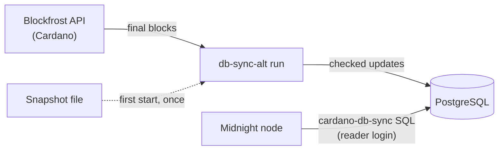

# db-sync-alt

Cardano data for a Midnight node in a small PostgreSQL database, instead of a
full Cardano node and cardano-db-sync stack.

db-sync-alt follows Cardano through the Blockfrost API and serves a Midnight
node the cardano-db-sync tables its queries read, from PostgreSQL, through a
read-only login. The node's SQL runs unchanged.

db-sync-alt keeps 7 days of detailed data, the range a Midnight node can start
syncing from, plus the historic data the node still needs
([limitations](docs/limitations.md#history-older-than-the-window)).

> This whole project is vibe coded. If you use it for a real application that
> manages any real money, that money will likely be lost. This project is for
> experimentation and development.



- **Small.** About 14 GiB less memory and 63 GB less disk than a Cardano node
  with cardano-db-sync ([comparison](#compared-with-the-full-stack)).
- **Never silently wrong.** Events come from transaction bytes whose hashes
  are checked; block headers, epoch parameters and stake distributions are
  the provider's answers, checked for consistency (links, sums, the epoch not
  moving during the read). While the database is not serving, the node's
  queries fail with SQLSTATE 55000 instead of returning empty answers.
- **Keeps serving.** The node reads the last update while db-sync-alt is
  stopped or restarting.
- **One binary.** No PostgreSQL client tools, no configuration file.

## System requirements

- Linux x86-64 with glibc 2.39 or newer, or Docker.
- PostgreSQL 17+ ([setup](docs/postgresql.md)).
- A Blockfrost API key.
- Recommended: a database snapshot file for the first start, from the
  [release page](https://github.com/midnight-experiments/db-sync-alt/releases).
  Without one, `db-sync-alt rebuild` builds the database from the provider
  ([rebuild](docs/rebuild.md)).

| Program | Version | Memory | Disk |
| --- | --- | --- | --- |
| Mainnet db-sync-alt | 0.5.1 | 20 MiB + 222 MiB PostgreSQL | 1 GB |
| Mainnet Midnight node | 2.1.101 | 3.7 GiB | 436 GB |
| Preprod db-sync-alt | 0.5.1 | 16 MiB + 49 MiB PostgreSQL | 0.1 GB |
| Preprod Midnight node | 2.1.101 | 1.7 GiB | 394 GB |

Memory is without file cache. Disk is the PostgreSQL data directory with three
daily snapshot files and, for the Midnight node, its archive database. More
figures: [database](docs/postgresql.md#size-and-connections),
[snapshot files](docs/snapshots.md#what-a-file-contains),
[provider requests](docs/provider.md#catching-up),
[binary and image](deploy/README.md#the-image).

## Compared with the full stack

Without db-sync-alt, the Cardano data of a Midnight node comes from a Cardano
node, cardano-db-sync and its PostgreSQL database. On Preprod, with swap and
file cache counted as memory:

| Original full stack | Memory | Disk | db-sync-alt stack | Memory | Disk |
| --- | ---: | ---: | --- | ---: | ---: |
| Cardano node | 6.70 GiB | 21.7 GB | db-sync-alt | 0.02 GiB | 0.01 GB |
| cardano-db-sync | 5.36 GiB | 3.2 GB | PostgreSQL 17 | 0.12 GiB | 0.08 GB |
| PostgreSQL 15 | 2.20 GiB | 38.6 GB | | | |
| **Total** | **14.26 GiB** | **63.5 GB** | **Total** | **0.14 GiB** | **0.09 GB** |

About 14 GiB less memory and 63 GB less disk. The Midnight node itself is the
same in both stacks.

## Install

The release binary for Linux x86-64 is built on Ubuntu 24.04:

```sh
version=0.5.1
base=https://github.com/midnight-experiments/db-sync-alt/releases/download/v$version
curl -fLO "$base/db-sync-alt-$version-linux-x86_64.tar.gz"
curl -fLO "$base/SHA256SUMS"
sha256sum --check SHA256SUMS
tar -xzf "db-sync-alt-$version-linux-x86_64.tar.gz"
sudo install -m 0755 "db-sync-alt-$version-linux-x86_64/db-sync-alt" /usr/local/bin/
db-sync-alt --version
```

The archive also holds the license texts of everything the binary is built
from. The image is `ghcr.io/midnight-experiments/db-sync-alt:0.5.1`; its
entry point is the binary and its default command is `run`. The Compose
deployment runs it next to its own PostgreSQL server:
[`deploy/README.md`](deploy/README.md).

## First start

The recommended first start restores a snapshot file. Get the file of your
network and its content digest from the release page. Then start the service
on the empty database:

```sh
db-sync-alt run --network mainnet \
  --database 'host=db.example dbname=db_sync_alt user=db_sync_alt_owner' \
  --password-file /etc/db-sync-alt/owner.password \
  --tls-root-cert /etc/db-sync-alt/root-ca.crt \
  --provider-key-file /etc/db-sync-alt/blockfrost-mainnet.key \
  --reader db_sync_alt_reader \
  --snapshot mainnet-<target>-<digest>.snapshot \
  --expect-content-digest <content digest> \
  --snapshot-dir /var/lib/db-sync-alt/snapshots
```

What the command does:

- Restores the snapshot file into the empty database.
- Gives the reader login the rights the node needs.
- Catches up from the file's block to the chain's tip, then follows the chain.

Good to know:

- It runs in the foreground. SIGINT or SIGTERM stops it.
- The same command continues where it stopped. `--snapshot` is read only when
  a restore is needed, so it may stay set.
- With `--snapshot-dir` it writes a snapshot file every day: the database's
  backup. Every file in that directory with the network's daily name pattern
  belongs to the rotation.
- Every flag can also be given as an environment variable
  ([configuration](docs/configuration.md)).

Without a snapshot file, build the database from the provider with
`db-sync-alt rebuild`, then start `run` on it without `--snapshot`. A build
sends many more requests than a restore and runs for hours
([rebuild](docs/rebuild.md)).

```sh
curl -i http://127.0.0.1:18080/health
curl -s http://127.0.0.1:18080/status
```

`/health` answers 200 once the database serves at the tip and the reader login
has exactly its rights, otherwise 503 with reason codes. `/status` holds the
whole picture in every state: position, lag, progress, provider calls per
day, the last update and error ([operations](docs/operations.md)).

## Connect a Midnight node

Give the node the reader login, the server's certificate authority, and the
network's security parameter:

```sh
DB_SYNC_POSTGRES_CONNECTION_STRING='postgresql://db_sync_alt_reader:<password>@<host>:5432/db_sync_alt'
SSL_ROOT_CERT=/path/to/root-ca.crt
CARDANO_SECURITY_PARAMETER=2160
```

The node connects only over TLS. The reader login can read the node's eleven
views and nothing else. Details and checks:
[connect a node](docs/connect-a-node.md); the supported node release:
[compatibility](docs/compatibility.md).

## Code

A Rust workspace. What each folder holds:

| Folder | What it holds |
| --- | --- |
| `crates/db-sync-alt` | The program itself: the command line that starts every command. |
| `crates/dsa-chain` | Cardano, without any I/O: reads blocks and transactions, knows each network's addresses and assets, and decides what is kept. |
| `crates/dsa-provider` | The Blockfrost client: one method per request, pacing and limits. |
| `crates/dsa-store` | The PostgreSQL database: its tables and the node's read-only access, restore, snapshot files, verification, pruning and the comparison. |
| `crates/dsa-service` | The running service: follows the chain, retries, upkeep, `/health` and `/status`; the build from the provider. |
| `crates/dsa-testkit` | Test support only: a transaction builder, a fake provider and generated chains. |

Around them: `deploy` (the container image and the Compose deployment), `docs`,
`tools/corpus` (records real provider answers for tests), `reference` (pinned
copies of the Midnight node's sources, where the queries come from) and
`profiles` (node settings used as test input). Each network's addresses and
assets are compiled into the binary from `crates/dsa-chain/profiles`. More in
[contributing](CONTRIBUTING.md).

## Documentation

- [Configuration](docs/configuration.md): every flag and variable.
- [Operations](docs/operations.md): states, `/health`, `/status`, logs, exit
  statuses, upkeep, the retention, a closed gate.
- [Snapshot files](docs/snapshots.md): restore, write, verify.
- [Rebuild](docs/rebuild.md): a database from the provider alone, without a
  snapshot file.
- [Comparison](docs/comparison.md): the node's queries against two databases.
- [Provider](docs/provider.md): requests, pace, refusals, measured costs.
- [PostgreSQL](docs/postgresql.md) and [connect a node](docs/connect-a-node.md).
- [Compatibility](docs/compatibility.md) and [limitations](docs/limitations.md).
- [Troubleshooting](docs/troubleshooting.md) and [glossary](docs/glossary.md).
- [Contributing](CONTRIBUTING.md), [security](SECURITY.md),
  [changelog](CHANGELOG.md).

Licensed under [Apache-2.0](LICENSE) · [Third-party notices](THIRD_PARTY_NOTICES.md)
