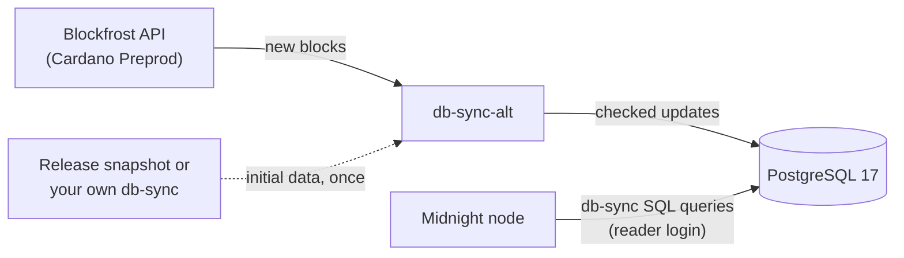

# db-sync-alt

Cardano data for a Midnight node in a small PostgreSQL database, instead of a
full Cardano node and cardano-db-sync stack.

- **Up to 83 % less memory:** run a full Midnight node with up to 83 % less
  memory than with a Cardano node and cardano-db-sync
  ([memory and disk](#memory-and-disk)).
- **About 58 GiB less disk:** only the Cardano data Midnight uses is kept, 1.5 GiB
  instead of 59.1 GiB.
- **Same queries:** the Midnight node runs its usual cardano-db-sync SQL against
  db-sync-alt's PostgreSQL 17 database, with a read-only login.
- **Sources:** follows Cardano through the Blockfrost API; starts from a
  published snapshot or from your own db-sync.
- **Never silently wrong:** every update is verified before it is published; with
  nothing verified published, the node's queries fail instead of returning empty
  answers.
- **Keeps serving:** the node reads the last published update while db-sync-alt
  is stopped or restarting.

> This whole project is vibe coded. If you use it for a real application that
> manages any real money, that money will likely be lost. This project is for
> experimentation and development.



## Memory and disk

Measured on a running Preprod deployment. Memory is RAM plus swap plus the
inactive file cache.

| Original full stack | GiB of memory | db-sync-alt stack | GiB of memory |
| --- | ---: | --- | ---: |
| Midnight node | 1.30 | Midnight node | 1.30 |
| Cardano node | 6.70 | db-sync-alt | 0.05 |
| cardano-db-sync | 5.36 | PostgreSQL 17 | 1.24 |
| PostgreSQL 15 | 2.20 | | |
| **Total** | **15.56** | **Total** | **2.59** |

About 83 % less memory. Both stacks run the same Midnight node process.

| Original full stack | GiB on disk | db-sync-alt stack | GiB on disk |
| --- | ---: | --- | ---: |
| Midnight node (archive) | 339.08 | Midnight node (archive) | 339.08 |
| Cardano node | 20.21 | db-sync-alt | 0.16 |
| cardano-db-sync | 2.97 | PostgreSQL 17 | 1.34 |
| PostgreSQL 15 | 35.95 | | |
| **Total** | **398.20** | **Total** | **340.57** |

About 58 GiB less disk. Data and configuration only, no container images or
logs. The PostgreSQL database grows with each update.

## Requirements

- Linux, Python 3.11 or newer, Git.
- PostgreSQL 17 and its client tools `pg_dump` and `pg_restore`
  ([provision PostgreSQL](docs/operations.md#provision-postgresql)).
- A Blockfrost API key.
- Initial data: the published Preprod snapshot or your own db-sync (see
  [first run](#first-run)).
- Docker (optional): see [Docker / Compose](docs/docker.md).

## Install

```sh
git clone https://github.com/midnight-experiments/db-sync-alt.git
cd db-sync-alt
python3 -m venv ~/.local/share/db-sync-alt/venv
~/.local/share/db-sync-alt/venv/bin/pip install --require-hashes -r requirements.lock
~/.local/share/db-sync-alt/venv/bin/pip install --no-deps --no-build-isolation .
~/.local/share/db-sync-alt/venv/bin/db-sync-alt --version
```

`requirements.lock` pins every dependency by hash. The examples below call
`db-sync-alt` directly; put `~/.local/share/db-sync-alt/venv/bin` on your `PATH`
or use the full path.

## First run

db-sync-alt never starts from an empty database: it needs verified initial
data, a ready [generation](docs/glossary.md#generation) of Preprod history. There
are two ways to get it.

Both ways read the two database passwords and the Blockfrost key from private
files. Create them, then put one value in each with any editor:

```sh
mkdir -p -m 700 ~/.config/db-sync-alt
for f in owner.password reader.password blockfrost-preprod.key; do
  install -m 600 /dev/null ~/.config/db-sync-alt/$f
done
```

`owner.password` and `reader.password` hold the passwords of the owner and
reader logins created during
[provisioning](docs/operations.md#provision-postgresql); `blockfrost-preprod.key`
holds your Blockfrost API key.

### Option A: the published Preprod snapshot

The 0.1.0 release carries a db-sync-alt backup of Cardano Preprod up to block
5,366,232 (the snapshot), its manifest and a checksum file:

| File | Size |
| --- | ---: |
| `db-sync-alt-0.1.0-preprod-5366232.dump` | 170 MB |
| `db-sync-alt-0.1.0-preprod-5366232.manifest.json` | 0.1 MB |
| `SHA256SUMS` | < 0.1 MB |

The snapshot was built with this release from a cardano-db-sync database
([option B](#option-b-build-it-from-your-own-db-sync)), without Blockfrost
requests, on PostgreSQL 17. With 1 CPU and 1 GiB for PostgreSQL, restoring it
takes about 4 minutes and verifying it about 2 more; the restored database is
about 750 MB.

Download the three files into one directory, check them, then start db-sync-alt
on your empty database from that directory:

```sh
sha256sum --check SHA256SUMS
db-sync-alt run --network preprod \
  --blockfrost-key-file ~/.config/db-sync-alt/blockfrost-preprod.key \
  --database-url postgresql://127.0.0.1:5432/db_sync_alt \
  --database-user db_sync_alt_owner --database-password-file ~/.config/db-sync-alt/owner.password \
  --reader-role db_sync_alt_reader --reader-password-file ~/.config/db-sync-alt/reader.password \
  --archive db-sync-alt-0.1.0-preprod-5366232.dump \
  --manifest db-sync-alt-0.1.0-preprod-5366232.manifest.json
```

db-sync-alt restores and verifies the snapshot, upgrades it to schema 5 (reading
each stored epoch's maximum transaction size from Blockfrost, 2 requests per
stored epoch), then serves it and follows new blocks from Blockfrost; `/health` returns 200 once it has caught up. Catching up
from the snapshot costs Blockfrost requests ([costs](docs/costs.md)). It runs in
the foreground: Ctrl-C stops it and the same command resumes it. All options:
`db-sync-alt run --help`.

### Option B: build it from your own db-sync

If you run cardano-db-sync 13.7.1.0 or 13.8.0.0 for Preprod with its retained
core/full history,
db-sync-alt can build the initial data from it once: read-only, without
Blockfrost requests, in about 18 minutes for Preprod. Then run
`db-sync-alt upgrade` and `db-sync-alt run` without `--archive`. See
[build initial data from your own db-sync](docs/operations.md#build-initial-data-from-your-own-db-sync).

## Upgrade an existing database

This version needs a schema-5 database. A database of 0.3.x or earlier holds
each epoch's nonce but not the epoch's maximum transaction size, which
midnight-node 2.1.101 reads. Stop the service after a publication
(`db-sync-alt status` shows no pending generation) and stop the node (the
upgrade's final transaction locks the node's `epoch_param` while it verifies the
whole database), then run once, with the service's Blockfrost settings:

```sh
db-sync-alt upgrade --service db_sync_alt
```

The upgrade reads every stored epoch's `max_tx_size` twice from Blockfrost (2
requests per stored epoch; `status` shows the count) and refuses unless both
reads agree; a cardano-db-sync of the network can be given instead with
`--source-service` and `--source-attestation`. Then start the service with this
version, then the node. There is no downgrade: 0.3.x refuses an upgraded database, so take a
`db-sync-alt backup` with the earlier version first if you may need to go back,
and go back with that version's `db-sync-alt restore`. See
[upgrade to schema 5](docs/recovery.md#upgrade-to-schema-5).

## Connect a Midnight node

Point the node's db-sync settings at db-sync-alt's database, with the reader
login:

```sh
DB_SYNC_POSTGRES_CONNECTION_STRING='postgresql://db_sync_alt_reader:<password>@<host>:5432/db_sync_alt'
CARDANO_SECURITY_PARAMETER=2160
```

- `<host>` is your PostgreSQL server as the node reaches it; `<password>` is the
  reader login's password you chose when you created it.
- TLS is your PostgreSQL server's configuration, as for cardano-db-sync. Without
  TLS on the server, the node needs `ALLOW_NON_SSL=true`; then keep the
  connection on loopback or a private network.
- `CARDANO_SECURITY_PARAMETER` must equal the network's security parameter k
  (2160 on Mainnet and Preprod, 432 on Preview), and the node's Cardano
  addresses and policies must be the profile's: db-sync-alt cannot see the
  node's settings.

The reader can read only the relations the node's queries use. Details:
[connect a Midnight node](docs/connect-a-node.md).

## Health and status

```sh
curl -i http://127.0.0.1:18080/health
curl http://127.0.0.1:18080/status
```

`/health` returns 200 when db-sync-alt is ready and up to date and the reader
login reads the node's relations, otherwise 503 with reason codes. `/status`
returns 200 with the full state, healthy or not, including the reader login's
settings, report-only `warnings` and the integrity base (`integrity`: its
generation and when its checkpoint was written). Every 6 hours by default the
service writes an [integrity checkpoint](docs/operations.md#integrity-checkpoints);
publication waits for it and `sync` reads `checkpointing`.
[Troubleshooting](docs/troubleshooting.md) explains every code.

## Status and roadmap

db-sync-alt **0.4.5** is experimental. It serves the SQL queries of **Midnight
node 2.1.101**, including the epoch `max_tx_size` its cost-based cNIGHT
observation reads and, from its coverage start, the token bridge data its bridge
query reads ([bridge readiness](docs/connect-a-node.md#bridge-readiness)).

- **Networks** (`--network`): **Preprod** is supported and tested end to end.
  The **Mainnet** and **Preview** profiles are packaged but not tested on their
  real chains, only on synthetic data ([networks](docs/networks.md)).
- **PostgreSQL 17**, which you provide, as you would for cardano-db-sync. It is
  the major version the Midnight node's reference environment runs its
  cardano-db-sync database on, so db-sync-alt's database can live on the same
  PostgreSQL 17 server as the other databases of a Midnight deployment
  ([sharing a server](docs/operations.md#share-a-postgresql-17-server)).

See the [compatibility matrix](docs/compatibility.md) and
[limitations](docs/limitations.md).

Planned next:

- Cardano Mainnet and Preview built and followed end to end;
- a bound on how much update history the database keeps.

## Blockfrost costs

Measured at the Preprod chain tip:

| Work | Requests per day |
| --- | ---: |
| Polling the chain tip every 20 seconds | ≈ 8,700 |
| Publishing new blocks (≈ 9 requests per block) | ≈ 24,700 |
| **Total** | **≈ 33,400** |

Catching up after a pause costs more, in proportion to the blocks missed. The
default daily ceiling is 50,000 requests. The key is read from a private file;
see [costs](docs/costs.md).

## More

[Architecture](docs/architecture.md) · [Glossary](docs/glossary.md) ·
[Networks](docs/networks.md) · [Operations](docs/operations.md) · [Backup and recovery](docs/recovery.md) ·
[Development](docs/development.md) · [Contributing](CONTRIBUTING.md) ·
[Security](SECURITY.md) · [Changelog](CHANGELOG.md)

Licensed under [Apache-2.0](LICENSE) · [Third-party notices](THIRD_PARTY_NOTICES.md)
