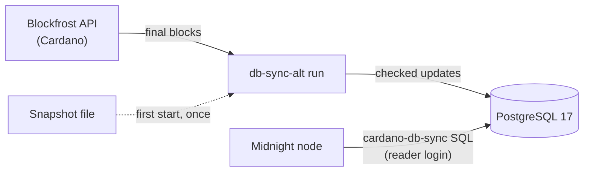

# db-sync-alt

Cardano data for a Midnight node in a small PostgreSQL database, instead of a
full Cardano node and cardano-db-sync stack.

db-sync-alt follows Cardano through the Blockfrost API and serves
**Midnight node 2.1.101** the cardano-db-sync tables its queries read, from
PostgreSQL 17, through a read-only login. The node's SQL runs unchanged.

The database keeps only what the node can still ask for: the events of the
last 7 days (the retention, counted from when this database first served them),
the Cardano outputs of Midnight's addresses and assets that are still unspent,
and a few governance records and epoch values. Everything older is deleted as
the chain advances, so the database stays small: 0.4 GB on Mainnet
([system requirements](#system-requirements)).

> This whole project is vibe coded. If you use it for a real application that
> manages any real money, that money will likely be lost. This project is for
> experimentation and development.



- **Small.** About 14 GiB less memory and 63 GB less disk than a Cardano node
  with cardano-db-sync ([comparison](#compared-with-the-full-stack)).
- **Never silently wrong.** Events come from transaction bytes whose hashes
  are checked; block headers, epoch parameters and stake distributions are
  the provider's answers, checked for consistency (links, sums, the epoch not
  moving during the read). While the database is not serving, the node's
  queries fail with SQLSTATE 55000 instead of returning empty answers.
- **Keeps serving.** The node reads the last update while db-sync-alt is
  stopped or restarting.
- **One binary.** No PostgreSQL client tools, no configuration file.

## System requirements

- Linux x86-64 with glibc 2.39 or newer, or Docker.
- PostgreSQL 17+ ([setup](docs/postgresql.md)).
- A Blockfrost API key.
- A database snapshot file for the first start, from the
  [release page](https://github.com/midnight-experiments/db-sync-alt/releases).

| Program | Version | Memory | Disk |
| --- | --- | --- | --- |
| Mainnet db-sync-alt | 0.5.0 | 20 MiB + 222 MiB PostgreSQL | 1 GB |
| Mainnet Midnight node | 2.1.101 | 3.7 GiB | 436 GB |
| Preprod db-sync-alt | 0.5.0 | 16 MiB + 49 MiB PostgreSQL | 0.1 GB |
| Preprod Midnight node | 2.1.101 | 1.7 GiB | 394 GB |

Memory is without file cache. Disk is the PostgreSQL data directory with three
daily snapshot files and, for the Midnight node, its archive database. More
figures: [database](docs/postgresql.md#size-and-connections),
[snapshot files](docs/snapshots.md#what-a-file-contains),
[provider requests](docs/provider.md#catching-up),
[binary and image](deploy/README.md#the-image).

## Compared with the full stack

Without db-sync-alt, the Cardano data of a Midnight node comes from a Cardano
node, cardano-db-sync and its PostgreSQL database. On Preprod, with swap and
file cache counted as memory:

| Original full stack | Memory | Disk | db-sync-alt stack | Memory | Disk |
| --- | ---: | ---: | --- | ---: | ---: |
| Cardano node | 6.70 GiB | 21.7 GB | db-sync-alt | 0.02 GiB | 0.01 GB |
| cardano-db-sync | 5.36 GiB | 3.2 GB | PostgreSQL 17 | 0.12 GiB | 0.08 GB |
| PostgreSQL 15 | 2.20 GiB | 38.6 GB | | | |
| **Total** | **14.26 GiB** | **63.5 GB** | **Total** | **0.14 GiB** | **0.09 GB** |

About 14 GiB less memory and 63 GB less disk. The Midnight node itself is the
same in both stacks.

## Install

The release binary for Linux x86-64 is built on Ubuntu 24.04:

```sh
version=0.5.0
base=https://github.com/midnight-experiments/db-sync-alt/releases/download/v$version
curl -fLO "$base/db-sync-alt-$version-linux-x86_64.tar.gz"
curl -fLO "$base/SHA256SUMS"
sha256sum --check SHA256SUMS
tar -xzf "db-sync-alt-$version-linux-x86_64.tar.gz"
sudo install -m 0755 "db-sync-alt-$version-linux-x86_64/db-sync-alt" /usr/local/bin/
db-sync-alt --version
```

The archive also holds the license texts of everything the binary is built
from. The image is `ghcr.io/midnight-experiments/db-sync-alt:0.5.0`; its
entry point is the binary and its default command is `run`. The Compose
deployment runs it next to its own PostgreSQL 17 server:
[`deploy/README.md`](deploy/README.md).

## First start

Get the snapshot file of your network and its content digest from the release
page. Then start the service on the empty database:

```sh
db-sync-alt run --network mainnet \
  --database 'host=db.example dbname=db_sync_alt user=db_sync_alt_owner' \
  --password-file /etc/db-sync-alt/owner.password \
  --tls-root-cert /etc/db-sync-alt/root-ca.crt \
  --provider-key-file /etc/db-sync-alt/blockfrost-mainnet.key \
  --reader db_sync_alt_reader \
  --snapshot mainnet-<target>-<digest>.snapshot \
  --expect-content-digest <content digest> \
  --snapshot-dir /var/lib/db-sync-alt/snapshots
```

The service restores the file, grants the reader login the node's rights,
catches up from the file's target to the chain's tip and then follows it. It
runs in the foreground; SIGINT or SIGTERM stops it, and the same command
continues: `--snapshot` is read only when a restore is needed, so it may stay
set. With `--snapshot-dir` it writes a snapshot file every day, the database's
backup; every file of the network's daily name pattern in that directory
belongs to the rotation.
Every flag can also be given as an environment variable
([configuration](docs/configuration.md)).

```sh
curl -i http://127.0.0.1:18080/health
curl -s http://127.0.0.1:18080/status
```

`/health` answers 200 once the database serves at the tip and the reader login
has exactly its rights, otherwise 503 with reason codes. `/status` holds the
whole picture in every state: position, lag, progress, provider calls per
day, the last update and error ([operations](docs/operations.md)).

## Connect a Midnight node

Give the node the reader login, the server's certificate authority, and the
network's security parameter:

```sh
DB_SYNC_POSTGRES_CONNECTION_STRING='postgresql://db_sync_alt_reader:<password>@<host>:5432/db_sync_alt'
SSL_ROOT_CERT=/path/to/root-ca.crt
CARDANO_SECURITY_PARAMETER=2160
```

Midnight node 2.1.101 connects only over TLS. The reader login can read the
node's eleven views and nothing else. Details and checks:
[connect a node](docs/connect-a-node.md).

## Documentation

- [Configuration](docs/configuration.md): every flag and variable.
- [Operations](docs/operations.md): states, `/health`, `/status`, logs, exit
  statuses, upkeep, the retention, a closed gate.
- [Snapshot files](docs/snapshots.md): restore, write, verify.
- [Comparison](docs/comparison.md): the node's queries against two databases.
- [Provider](docs/provider.md): requests, pace, refusals, measured costs.
- [PostgreSQL](docs/postgresql.md) and [connect a node](docs/connect-a-node.md).
- [Compatibility](docs/compatibility.md) and [limitations](docs/limitations.md).
- [Troubleshooting](docs/troubleshooting.md) and [glossary](docs/glossary.md).
- [Contributing](CONTRIBUTING.md), [security](SECURITY.md),
  [changelog](CHANGELOG.md).

Licensed under [Apache-2.0](LICENSE) · [Third-party notices](THIRD_PARTY_NOTICES.md)
