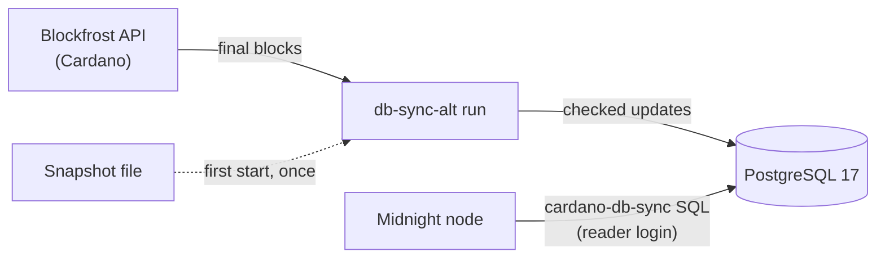

# db-sync-alt

Cardano data for a Midnight node in a small PostgreSQL database, instead of a
full Cardano node and cardano-db-sync stack.

db-sync-alt follows Cardano through the Blockfrost API and serves
**Midnight node 2.1.101** the cardano-db-sync tables its queries read, from
PostgreSQL 17, through a read-only login. The node's SQL runs unchanged.

The database keeps only what the node can still ask for: the events of the
last 7 days (the retention, counted from when this database first served them),
the Cardano outputs of Midnight's addresses and assets that are still unspent,
and a few governance records and epoch values. Everything older is deleted as
the chain advances, so the database stays small: 194 MB on Mainnet right after
a restore ([measured](#requirements)).

> This whole project is vibe coded. If you use it for a real application that
> manages any real money, that money will likely be lost. This project is for
> experimentation and development.



- **Never silently wrong.** Every stored value comes from transaction bytes
  whose hashes are checked. While the database is not serving, the node's
  queries fail with SQLSTATE 55000 instead of returning empty answers.
- **Keeps serving.** The node reads the last update while db-sync-alt is
  stopped or restarting.
- **One binary.** No PostgreSQL client tools, no configuration file.

## Requirements

- Linux x86-64 with glibc 2.39 or newer, or Docker.
- PostgreSQL 17 with TLS, which you provide: a dedicated database, an owner
  login and a reader login for the node ([PostgreSQL](docs/postgresql.md)).
- A Blockfrost key for the network, in a file.
- A snapshot file of the network to start from.

Measured on 2026-11-23 with release builds on an x86-64 Linux host,
PostgreSQL 17 in a container:

| Measured | Mainnet | Preprod |
| --- | --- | --- |
| Memory of the service, resident | 26 MB at the tip; peak 42 MB catching up 75,000 blocks | 15 MB at the tip; peak 17 MB |
| [Database](docs/postgresql.md#size-and-connections) | 194 MB after restoring a 7-day window; 376 MB holding 25 days of blocks, before its first pruning | 18 MB after a restore; 20 MB after following for three hours |
| [Snapshot file](docs/snapshots.md#what-a-file-contains) | 32.9 MB for a 7-day window; 44.1 MB for 24 days | 1.5 to 1.6 MB |
| [Restore](docs/snapshots.md#restore); [writing a file](docs/snapshots.md#write-a-file) | 19.9 s; 13.0 s for 24 days | 0.5 to 0.7 s; 0.4 s |
| [Supply check](docs/operations.md#supply-check) | 1.1 s (247,986 unspent outputs) | — |
| [Provider requests](docs/provider.md#catching-up) | 0.92 a block catching up | 0.80 a block catching up; 233 an hour at the tip, about 5,600 a day |
| [Compose](deploy/README.md#postgresql-settings), two minutes after a first start | — | service container 4.8 MiB, PostgreSQL container 67 MiB |

The binary is 9.1 MB and the image 33 MB ([deployment](deploy/README.md#the-image)).
In a test, a restart of the service reached `following` in 0.19 s on a 185 MB
database ([operations](docs/operations.md#start)).

## Install

The release binary for Linux x86-64 is built on Ubuntu 24.04:

```sh
version=0.5.0
base=https://github.com/midnight-experiments/db-sync-alt/releases/download/v$version
curl -fLO "$base/db-sync-alt-$version-linux-x86_64.tar.gz"
curl -fLO "$base/SHA256SUMS"
sha256sum --check SHA256SUMS
tar -xzf "db-sync-alt-$version-linux-x86_64.tar.gz"
sudo install -m 0755 "db-sync-alt-$version-linux-x86_64/db-sync-alt" /usr/local/bin/
db-sync-alt --version
```

The archive also holds the license texts of everything the binary is built
from. The image is `ghcr.io/midnight-experiments/db-sync-alt:0.5.0`; its
entry point is the binary and its default command is `run`. The Compose
deployment runs it next to its own PostgreSQL 17 server:
[`deploy/README.md`](deploy/README.md).

## First start

Get the snapshot file of your network and its content digest from the release
page. Then start the service on the empty database:

```sh
db-sync-alt run --network mainnet \
  --database 'host=db.example dbname=db_sync_alt user=db_sync_alt_owner' \
  --password-file /etc/db-sync-alt/owner.password \
  --tls-root-cert /etc/db-sync-alt/root-ca.crt \
  --provider-key-file /etc/db-sync-alt/blockfrost-mainnet.key \
  --reader db_sync_alt_reader \
  --snapshot mainnet-<target>-<digest>.snapshot \
  --expect-content-digest <content digest> \
  --snapshot-dir /var/lib/db-sync-alt/snapshots
```

The service restores the file, grants the reader login the node's rights,
catches up from the file's target to the chain's tip and then follows it. It
runs in the foreground; SIGINT or SIGTERM stops it, and the same command
continues (`--snapshot` is read only while the database is empty). With
`--snapshot-dir` it writes a snapshot file every day, the database's backup.
Every flag can also be given as an environment variable
([configuration](docs/configuration.md)).

```sh
curl -i http://127.0.0.1:18080/health
curl -s http://127.0.0.1:18080/status
```

`/health` answers 200 once the database serves at the tip and the reader login
has exactly its rights, otherwise 503 with reason codes. `/status` holds the
whole picture in every state: position, lag, progress, provider calls per
day, the last update and error ([operations](docs/operations.md)).

## Connect a Midnight node

Give the node the reader login, the server's certificate authority, and the
network's security parameter:

```sh
DB_SYNC_POSTGRES_CONNECTION_STRING='postgresql://db_sync_alt_reader:<password>@<host>:5432/db_sync_alt'
SSL_ROOT_CERT=/path/to/root-ca.crt
CARDANO_SECURITY_PARAMETER=2160
```

Midnight node 2.1.101 connects only over TLS. The reader login can read the
node's eleven views and nothing else. Details and checks:
[connect a node](docs/connect-a-node.md).

## Documentation

- [Configuration](docs/configuration.md): every flag and variable.
- [Operations](docs/operations.md): states, `/health`, `/status`, logs, exit
  statuses, upkeep, the retention, a closed gate.
- [Snapshot files](docs/snapshots.md): restore, write, verify.
- [Comparison](docs/comparison.md): the node's queries against two databases.
- [Provider](docs/provider.md): requests, pace, refusals, measured costs.
- [PostgreSQL](docs/postgresql.md) and [connect a node](docs/connect-a-node.md).
- [Compatibility](docs/compatibility.md) and [limitations](docs/limitations.md).
- [Troubleshooting](docs/troubleshooting.md) and [glossary](docs/glossary.md).
- [Contributing](CONTRIBUTING.md), [security](SECURITY.md),
  [changelog](CHANGELOG.md).

Licensed under [Apache-2.0](LICENSE) · [Third-party notices](THIRD_PARTY_NOTICES.md)
