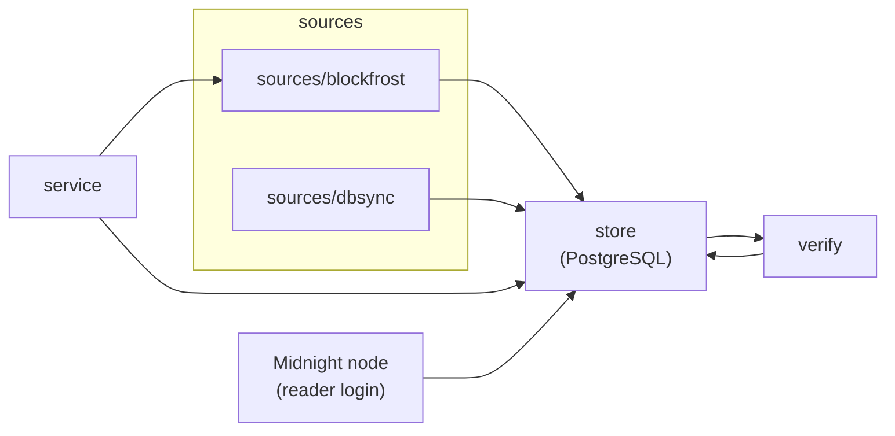

# Architecture

db-sync-alt is one Python package, `db_sync_alt`, with one command,
`db-sync-alt`. Data flows in one direction: **sources** produce facts, the
**store** keeps them in PostgreSQL as [generations](glossary.md#generation),
**verify** checks a generation before it is published, and the **service** runs
the follower and the health endpoints. The Midnight node reads the published
generation from PostgreSQL itself, with a reader login.

## Source tree

| Path | Responsibility |
| --- | --- |
| `src/db_sync_alt/cli/` | The `db-sync-alt` dispatcher; `run` (foreground launcher), `acquire` (build or extend generations), `compose` (private Compose configuration and the bundled server's provisioning) |
| `src/db_sync_alt/service/` | `runtime.py`: the service lifecycle, writer, reader grants and checks, observers; `health.py`: `/health` and `/status` |
| `src/db_sync_alt/sources/blockfrost/` | Blockfrost: HTTP client and request ledger (`provider.py`), CBOR decoding (`cbor.py`), fact adapter and full update (`adapter.py`), sync driver and accounted provider (`sync.py`), 20-second tip poller (`poller.py`), continuation of a ready store (`follow.py`) |
| `src/db_sync_alt/sources/dbsync/` | Read-only cardano-db-sync reader (`reader.py`) and the initial build from it (`acquire.py`) |
| `src/db_sync_alt/store/` | `database.py`: `PgStore` (generations, facts, membership, receipts, publication, locks); `incremental.py`: certified updates (schema 2 and later); `upgrade.py`: schema 1 → 2 → 3 → 4; `reader.py`: the node reader's grants; the SQL schema files |
| `src/db_sync_alt/verify/` | `store.py`: independent verification of a generation; `completion.py`: completion seals of an update |
| `src/db_sync_alt/backup.py` | PostgreSQL-native backup, restore, verify and status |
| `src/db_sync_alt/contract.py`, `node_queries.py` | The fact contract and profile; the Midnight node's SQL catalogue read from `reference/` |
| `profiles/`, `reference/` | Pinned upstream inputs, shipped inside the package |
| `deploy/` | Dockerfile, Compose file and its setup script |
| `tests/`, `tools/` | Tests by lane and the lane runner ([development](development.md)) |

## Generations and publication

Every acquisition fixes a [target](glossary.md#target) and a
[witness](glossary.md#witness) before it starts and writes into a *pending*
generation. Pending facts are never visible to the node. When the pending
generation is complete, the verifier checks the header chain from the start
cursor to the witness, the anchors, every receipt, the fact digests and the
profile identity; the update is sealed with a completion record and published in
one transaction under the publication lock, together with the served tables, so
a node query sees either the old or the new generation, never a mix.

The writer holds a PostgreSQL advisory lock for its whole life. A second writer
is refused (`writer_busy`); a writer that loses its connection exits instead of
reconnecting without the lock. A committed block that disagrees with the source
revokes serving (`canonical_conflict`). Headers above the target are provisional
and can be replaced after a fork without touching committed history.

Startup, backups and `db-sync-alt verify` verify the canonical generation in full
from the [integrity base](glossary.md#integrity-checkpoint): the base's fact
digests are recomputed and compared with its checkpoint, and every update
published after it is verified again. A successful startup verification, and a
periodic one while the service runs, makes the canonical generation the new base.
From schema 2 on, the follower publishes certified updates: each update is proved
against its already verified parent, so it does not re-read all history.

## Served tables

From schema 3 the node can read PostgreSQL directly. The schema `serve` holds the
ready generation in cardano-db-sync's shape — `block`, `tx`, `tx_out`, `tx_in`,
`ma_tx_out`, `multi_asset`, `datum`, `epoch_param`, `pool_hash`, `epoch_stake`
and, from schema 5, `tx_metadata` (the bridge metadata of key 6500973, `id` and
`tx_id` the transaction's positional ID) with db-sync's column names, base types and the eleven index names the node
checks — and `public` holds one view per table that adds only the
[serving gate](glossary.md#serving-gate). The rows are written in chain order
when the upgrade builds them and grow by appends inside each publication
transaction; a tip fork replaces the provisional headers above the target in the
same transaction. Verification compares every served row with the stored facts.

Before a generation is published the verifier also requires what the node's
queries rely on without being able to check it: the witness is the target plus
the network's k, headers are contiguous from the start cursor to the witness,
events and prerequisites are complete, every required epoch has its nonce and
`max_tx_size`, at least one stake row and (once completed) its end block, and
at least one spend is served. A generation acquired
from Blockfrost also holds the bridge metadata of every transaction with an
output at the ICS address in its new blocks, and no other, and every asset of the
ICS and reserve outputs it stores
([bridge readiness](connect-a-node.md#bridge-readiness)).

Only the owner and the roles db-sync-alt grants may connect to its database;
the node's reader gets CONNECT, SELECT on the eleven views and EXECUTE on the gate
once the database serves (the service at start, `restore --reader-role`,
`db-sync-alt grant-reader`), and the service refuses a reader that can do more.

The IDs the node bounds its event queries with are
[positional](glossary.md#positional-id): their order is the chain order, so an
older fact discovered late still falls inside the node's bounds. Assets, datums
and pools keep the stable IDs of the stored facts.

## Query boundary

The node's SQL runs unchanged on the eleven gated views; the SQL catalogue under
`reference/` (the unchanged Midnight node sources) is what the conformance
harness and the tests run. A view cannot see a statement's parameters, so the
database does not refuse a query by its range: the publication invariants above
make the ranges a correctly configured node asks for complete, and a node whose
k or addresses differ from the profile is an operator error
([node requirements](connect-a-node.md#node-requirements)). Every view raises
SQLSTATE 55000 when the database is revoked, restoring, not yet ready, or its
projection or served tables are not the ready generation's — also in plans that
were prepared and cached while it served — so the node gets an error, never an
empty answer, from a database that is not serving. Serving depends only on the
database's state: the node keeps reading the last published generation while
the service is stopped.

The service checks serving the way the node reads: as the reader, it runs a
gated query. A random advisory lock held by the writer's session proves that
this check and the owner's observations reach the database the writer holds.

## Provider accounting

Every Blockfrost request is reserved in a durable ledger before it is sent,
including failures. The ledger enforces the daily ceiling and the request rate;
the database keeps a per-job budget for polling and for each update. The poller
observes the chain tip every 20 seconds, independently of acquisition; health
reports gaps and missed ticks. No health request ever calls the provider. See
[costs](costs.md).
